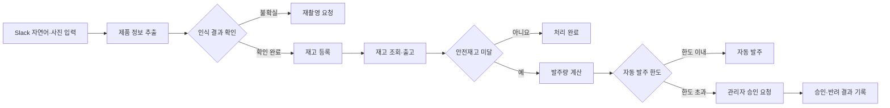

# KT 플라자 재고관리·발주 Agent

> Slack에서 자연어나 제품 사진으로 재고를 등록하고 조회·출고·안전재고 판단·발주 승인까지 처리하는 업무 자동화 Agent

## 프로젝트 개요

| 항목 | 내용 |
| --- | --- |
| 프로젝트 기간 | 2026.09 ~ 2026.10 |
| 팀 구성 | 6명 |
| 프로젝트 형태 | KT ICT AX 아카데미 팀 프로젝트 |
| 담당 역할 | 재고·발주 업무 분석 및 전체 서비스 흐름 설계 / 기능 배분 / 핵심 n8n 워크플로 구현 / 통합 검수 |
| 성과 | 최종평가 팀 최우수상 |

KT 플라자의 재고 업무를 대상으로 직원이 별도의 입력 화면을 오가지 않고 익숙한 Slack에서 재고 등록부터 발주 승인까지 처리할 수 있는 Agent를 개발했습니다.

## 시연 영상

| 재고관리·발주 Agent 시연 | KT 홍보영상 |
| --- | --- |
|  |  |
| [영상 보기](https://youtu.be/d7HrRj6if7w) | [영상 보기](https://youtu.be/OEVXbJmj_lY) |

## 문제 정의

프로젝트에서는 매장 재고 업무의 다음 과정을 자동화 대상으로 정의했습니다.

- 제품 라벨을 확인하고 품목과 규격 및 수량을 직접 입력
- 현재 재고와 안전재고를 비교해 부족 여부 확인
- 부족한 수량을 계산하고 발주 요청 작성
- 별도 단계에서 발주 승인 상태 확인

단순히 제품 정보를 인식하는 기능을 만드는 데 그치지 않고 입력된 정보가 실제 재고 변경과 발주 처리로 이어지는 전체 업무 흐름을 설계하는 것을 목표로 했습니다.

## 서비스 흐름

## 담당 역할

### 1. 재고·발주 업무를 데이터 처리 단위로 구체화

재고 등록과 조회부터 출고 및 발주 승인까지 필요한 데이터를 정의하고 각 단계에서 어떤 정보가 변경되며 다음 단계로 무엇을 전달해야 하는지 정리했습니다. 이를 기준으로 기능을 나누고 팀원별 구현 범위를 배분한 뒤 전체 워크플로를 통합했습니다.

### 2. 자연어·사진 입력을 재고 데이터에 연결

- 자연어에서 품목과 수량 추출
- 제품 사진에서 모델명과 용량 및 색상 인식
- 추출 정보를 기존 품목 데이터와 비교
- 사용자가 제품과 수량을 확인한 뒤 재고에 반영
- 사진 인식이 불확실하면 저장하지 않고 재촬영 요청

n8n의 각 노드 출력값을 확인하며 품목과 규격 및 수량이 다음 처리 단계의 필요한 항목에 전달되도록 데이터 연결을 수정했습니다.

### 3. 자동 처리와 사람의 확인이 필요한 지점을 구분

출고 후 현재 수량과 안전재고를 비교해 부족한 품목의 발주량을 계산하도록 설계했습니다. 기존 발주 이력을 조회해 중복 요청을 방지하고 설정 한도 이내는 자동 발주하며 한도를 초과한 요청은 Slack으로 관리자 승인을 요청하도록 분기했습니다.

승인 버튼의 응답에 따라 발주 상태를 갱신하고 승인·반려 결과를 Slack으로 안내해 처리 과정을 확인할 수 있도록 구성했습니다.

## 핵심 기능

| 기능 | 처리 내용 |
| --- | --- |
| 자연어 재고 등록 | 품목과 수량을 추출하고 사용자 확인 후 재고에 반영 |
| 사진 재고 등록 | 제품 규격을 인식하고 수량을 추가로 확인해 등록 |
| 인식 예외 처리 | 인식 결과가 불확실하면 재촬영 요청 |
| 재고 조회 | 전체 또는 특정 품목의 현재 수량과 안전재고 조회 |
| 출고 | 보유 수량 확인과 사용자 확인 후 재고 차감 |
| 안전재고 감지 | 현재 수량이 기준 아래로 내려가면 부족 상태 알림 |
| 발주량 계산 | 부족 수량을 기준으로 필요한 발주량 계산 |
| 자동 발주·승인 | 한도 이내 자동 처리 / 한도 초과 관리자 승인 요청 |
| 중복 발주 방지 | 기존 발주 이력을 확인해 동일 요청의 중복 처리 차단 |

## 기술 구성

- **Workflow**: n8n
- **Interface**: Slack API
- **AI**: Gemini Vision / 생성형 AI
- **Data**: Google Sheets / Google Drive
- **Data Processing**: JavaScript

## 결과와 배운 점

Slack 입력부터 재고 변경과 발주 승인까지 이어지는 전체 업무 흐름을 구현하고 시연했습니다. 최종평가에서는 팀 최우수상을 받았습니다.

이 프로젝트를 통해 업무 자동화는 AI가 정보를 읽는 기능만 만드는 것이 아니라 데이터가 어떻게 변경되고 사람이 어느 시점에 확인해야 하는지까지 설계하는 일임을 배웠습니다.

> 발표자료의 시간·비용 절감 수치는 실제 도입 결과가 아닌 프로젝트 가정에 따른 기대효과이므로 본 문서의 성과에서는 제외했습니다.
